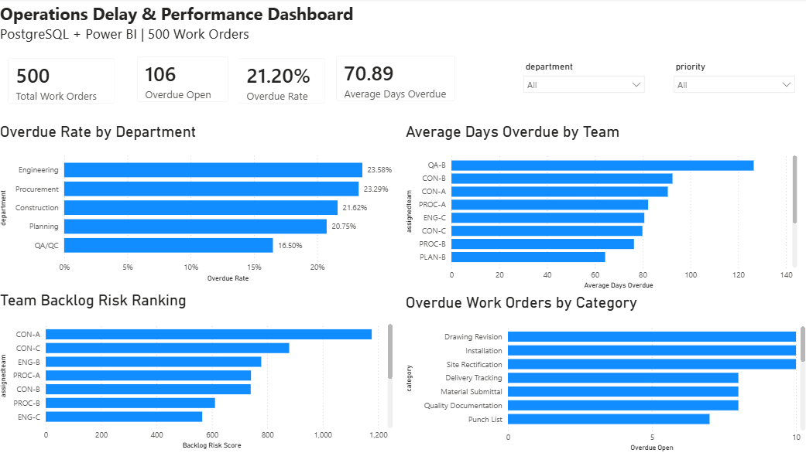

# Operations Delay & Performance Analysis

**Core analytics project · SQL + Power BI · Simulated data**

Analyzes operational backlog to distinguish workload volume, overdue rates, and aging risk, helping managers choose where to investigate and prioritize recovery work.

**Demonstrated snapshot:** 500 work orders · 106 overdue open · 21.20% overdue rate · 70.89 average overdue days.

[Read the detailed findings](insights/key-findings.md) · [Explore the SQL](sql) · [View source data](data/Portfolio_02_Work_Orders_500.csv)

## Business Problem

Managers need to identify bottlenecks across departments and teams. Raw overdue counts can obscure whether a team has a large workload, a high proportion of late work, or a small number of exceptionally old cases.

## Solution

**Data → SQL Analysis → KPI Visibility → Insight → Management Decision**

PostgreSQL queries explore the data, compare overdue workload and team performance, and drill into category and priority patterns. A reusable analytical view prepares the fields shown in the Power BI dashboard.

## Data

The repository contains **500 simulated work orders** across Engineering, QA/QC, Construction, Procurement, and Planning. Fields include dates, status, assigned team, priority, estimated/actual hours, and cost.

All overdue calculations use the fixed cutoff **16 August 2026**, matching the SQL and saved dashboard. The overdue rate uses all work orders as the denominator. Average overdue age uses overdue open work orders only.

## Analysis

| Script | Analytical purpose |
|---|---|
| [01 — Data exploration](sql/01_data_exploration.sql) | Inspect row counts and workload by status and department. |
| [02 — Overdue analysis](sql/02_overdue_analysis.sql) | Compare department overdue counts, rates, and aging. |
| [03 — Team analysis](sql/03_team_analysis.sql) | Compare team backlog volume, overdue age, and combined risk. |
| [04 — Category/priority investigation](sql/04_root_cause_analysis.sql) | Drill into QA-A's backlog and identify areas to investigate. |
| [05 — Analytical view](sql/05_analysis_view.sql) | Create `vw_work_order_analysis` for Power BI. |

**Backlog Risk Score = Overdue Items × Average Days Overdue.** This is a project-specific prioritization measure, not a standard industry KPI. Category and aging patterns identify investigation targets; they do not prove causal explanations.

## Decision Support

- Prioritize **CON-A** for backlog review: 13 overdue items with 90.54 average overdue days and a backlog risk score of 1,177.
- Review **QA-B's** two overdue items despite the small volume: their average overdue age is 126.50 days.
- Investigate **QA-A Quality Documentation**, with 4 of 9 work orders overdue (44.44%). Review aging in Inspection separately: 3 overdue items, 77 average overdue days, and a maximum of 117 days.
- Compare department rates as well as volumes: Engineering has the highest overdue rate at 23.58%, while Construction has more overdue work orders.

## Automated Action

The reusable SQL view calculates operational reporting fields for downstream analysis. This project supports management prioritization; it does not implement scheduled reporting, notifications, or work-order updates.

## Measured / Demonstrated Outcome

| Measure | Result at 16 August 2026 |
|---|---:|
| Total work orders | 500 |
| Overdue open work orders | 106 |
| Overdue rate, all work orders | 21.20% |
| Average overdue age, overdue open only | 70.89 days |

The saved dashboard and [findings](insights/key-findings.md) show how different risk measures lead to different management priorities. These are simulated-data findings; backlog reduction after intervention has not been measured.

## Tools and Outputs

PostgreSQL, SQL, pgAdmin 4, Power BI, and DAX as documented in the original project. The repository includes source CSV, SQL scripts, findings, and a dashboard screenshot. **The editable Power BI `.pbix` file is not included.**

## How to Run

1. Create a local PostgreSQL database and a `work_orders` table matching the CSV header, using lowercase unquoted column names. Use text for identifiers/categories/status, `DATE` for the three date columns, and numeric types for hours and cost.
2. Import [Portfolio_02_Work_Orders_500.csv](data/Portfolio_02_Work_Orders_500.csv) using pgAdmin's import tool, with its header enabled and blank completion dates treated as null.
3. Run scripts 01–04, then script 05 to create `vw_work_order_analysis`. Keep the supplied cutoff to reproduce the reported snapshot.
4. To rebuild the visual report, connect Power BI Desktop to that view and use the saved screenshot as a layout reference. To review the existing analysis, no Power BI installation is required.

Database creation and table DDL are not supplied as scripts. The instructions above describe the required setup rather than a one-command installation.

---

[Portfolio overview](https://github.com/23-06109#selected-projects) · [LinkedIn](https://www.linkedin.com/in/jimmyjrmanalon)
